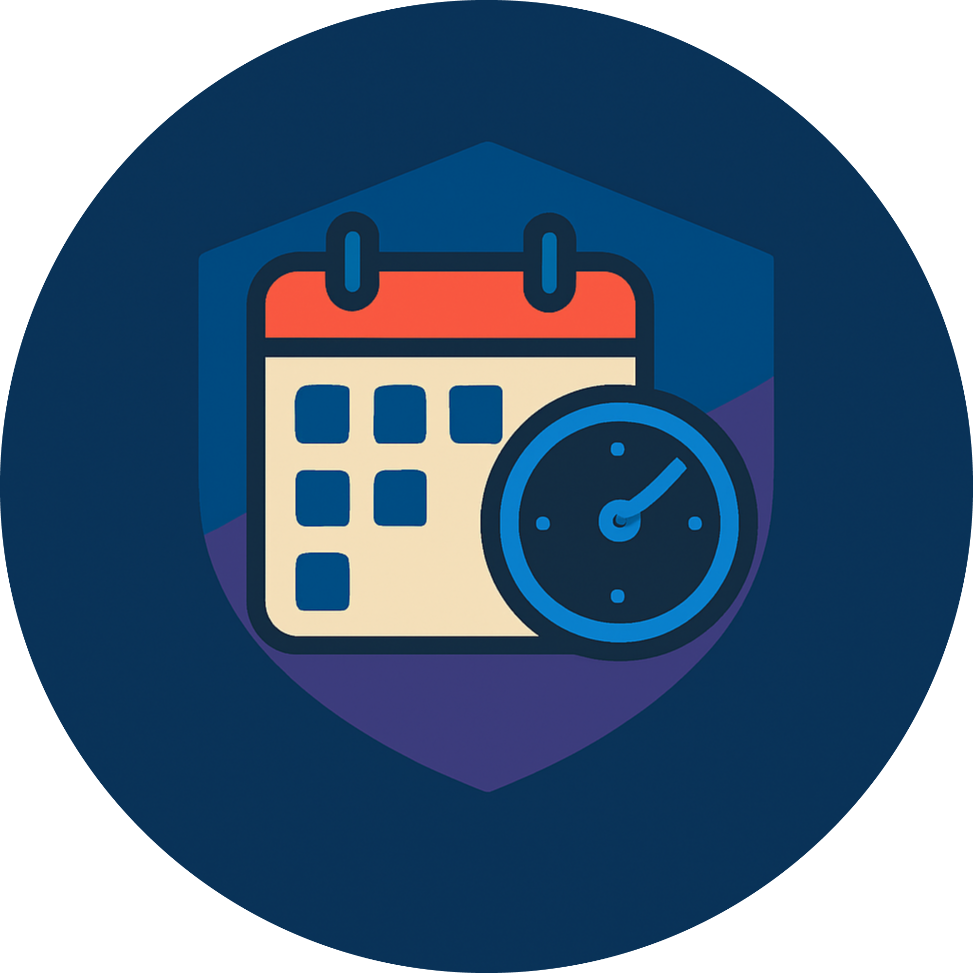
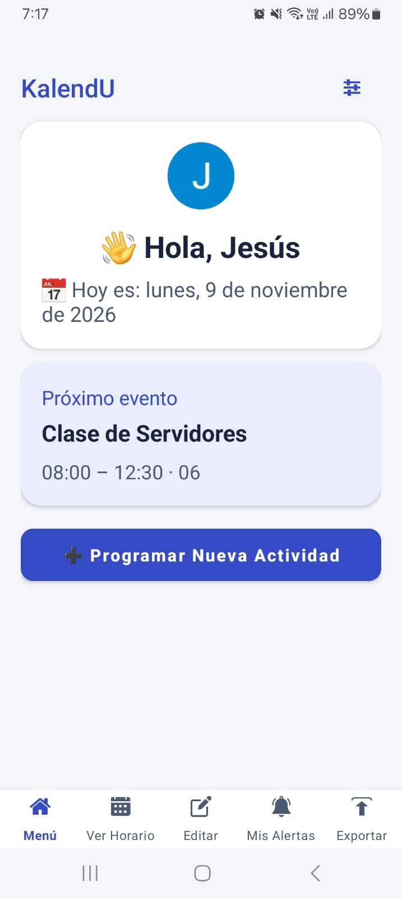
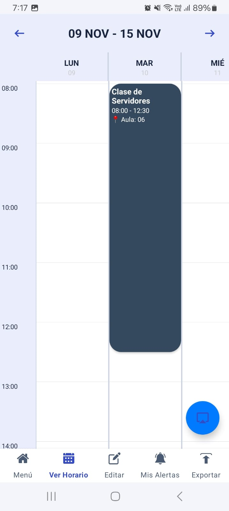
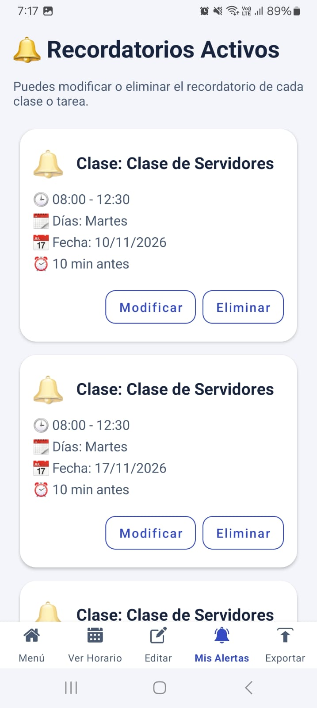
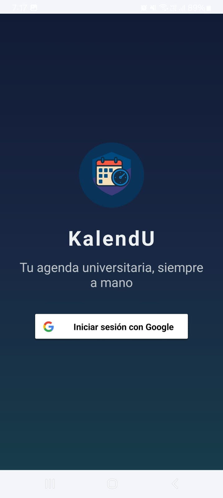
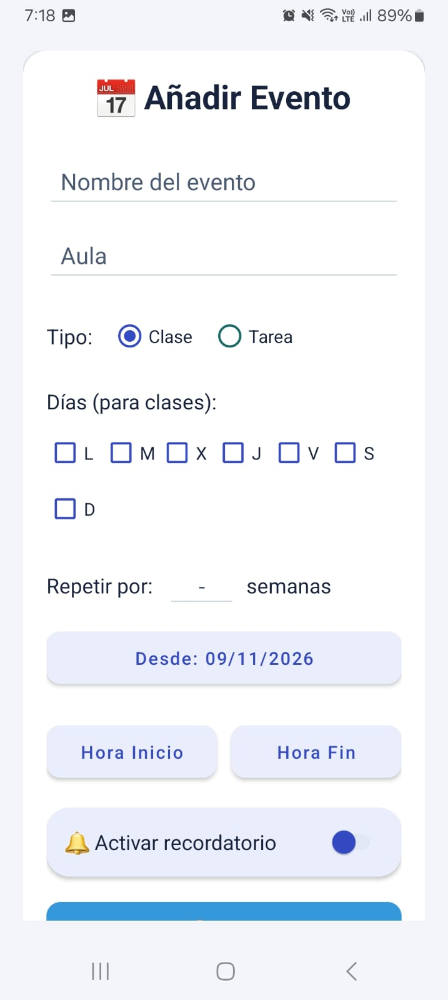
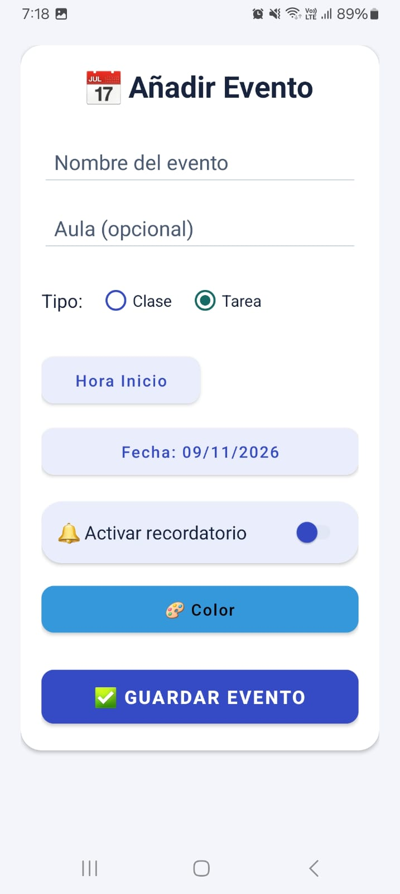
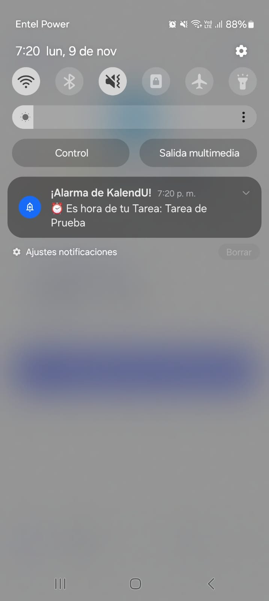
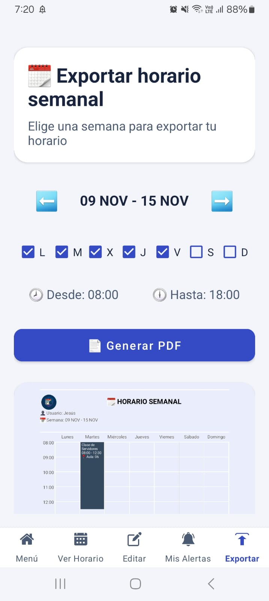
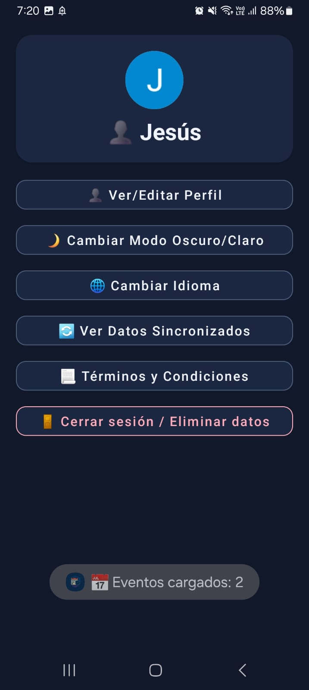

# KalendU

<p align="center">
  
</p>

**Agenda académica para Android.** Organiza tus clases y tareas, programa recordatorios y comparte tu horario semanal en PDF.

[](#instalar-o-ejecutar-kalendu)
[](#tecnologías-y-estructura-del-repositorio)
[](https://github.com/JesusLoza1506/Studentcalendar/actions/workflows/android.yml)

[Ver capturas](#capturas-en-el-celular) · [Instalar](#instalar-o-ejecutar-kalendu) · [Pruebas](#pruebas-y-github-actions)

## Índice

1. [Qué es KalendU](#qué-es-kalendu)
2. [Capturas en el celular](#capturas-en-el-celular)
3. [Funciones principales](#funciones-principales)
4. [Cómo usar la app](#cómo-usar-la-app)
5. [Instalar o ejecutar KalendU](#instalar-o-ejecutar-kalendu)
6. [Tecnologías y estructura del repositorio](#tecnologías-y-estructura-del-repositorio)
7. [Firebase y sincronización](#firebase-y-sincronización)
8. [Pruebas y GitHub Actions](#pruebas-y-github-actions)
9. [Estado y próximos pasos](#estado-y-próximos-pasos)
10. [Créditos y licencia](#créditos-y-licencia)

## Qué es KalendU

KalendU reúne el horario de clases y las entregas académicas en una agenda móvil. Está pensada para estudiantes que necesitan registrar clases recurrentes, consultar su semana y recibir avisos antes de una clase o una tarea. Desde la misma aplicación pueden generar un PDF del horario para guardarlo o compartirlo.

## Capturas en el celular

<table>
  <tr>
    <th>Inicio</th>
    <th>Horario semanal</th>
    <th>Recordatorios</th>
  </tr>
  <tr>
    <td align="center"></td>
    <td align="center"></td>
    <td align="center"></td>
  </tr>
  <tr>
    <td>Consulta el próximo evento y accede a las funciones de la agenda.</td>
    <td>Revisa tus clases y tareas dentro de la semana.</td>
    <td>Consulta los avisos configurados para tus eventos.</td>
  </tr>
</table>

## Funciones principales

### Cuenta y acceso

Inicia sesión con Google, actualiza tu perfil y cierra sesión desde los ajustes.

<details>
<summary>Ver pantalla de acceso</summary>



</details>

### Inicio

Muestra el próximo evento y permite acceder al horario, las tareas y los recordatorios.

### Clases y tareas

Registra clases con días, horas, color y repetición de hasta 26 semanas. También puedes crear tareas con fecha y hora de entrega. Al editar una serie se conservan las ocurrencias pasadas y se actualizan las futuras. Los eventos antiguos sin identificador de serie se editan o eliminan individualmente.

<details>
<summary>Ver formularios de clase y tarea</summary>

<table>
  <tr><th>Nueva clase</th><th>Nueva tarea</th></tr>
  <tr>
    <td align="center"></td>
    <td align="center"></td>
  </tr>
</table>

</details>

### Horario semanal

Muestra clases y tareas en una vista semanal. Puedes navegar entre semanas y ajustar los filtros para consultar el horario que te interesa.

### Recordatorios

Configura con cuánta anticipación quieres recibir un aviso. La app conserva los recordatorios confirmados de la cuenta activa para restaurarlos tras un reinicio. Los sonidos importados quedan en el dispositivo. Si falta el archivo, se utiliza el sonido de alarma del sistema.

<details>
<summary>Ver un aviso en Android</summary>



</details>

### Exportación a PDF

Genera una vista previa del horario semanal con clases y tareas. Desde ahí puedes guardar el PDF en una ubicación elegida con el selector de archivos de Android o compartirlo.

<details>
<summary>Ver la vista previa del PDF</summary>



</details>

### Ajustes y sincronización

Cambia entre modo claro y oscuro, elige uno de los cinco idiomas disponibles y consulta el estado de tus datos sincronizados. El borrado de la agenda pide confirmar la identidad con la misma cuenta.

<details>
<summary>Ver ajustes en modo oscuro</summary>



</details>

## Cómo usar la app

1. Inicia sesión con Google.
2. Añade una clase, elige los días y horarios, y configura cuántas semanas se repite.
3. Activa un recordatorio, elige la antelación y concede los permisos que solicite Android.
4. Abre el horario semanal para consultar la clase junto con tus tareas.
5. Genera el PDF de esa semana y elige si quieres guardarlo o compartirlo.

## Instalar o ejecutar KalendU

### Instalar un APK firmado

Cuando haya una versión publicada, encontrarás el APK firmado y su archivo SHA-256 en [GitHub Releases](https://github.com/JesusLoza1506/Studentcalendar/releases). Usa un dispositivo con Android 6 (API 23) o superior y servicios de Google Play para el acceso con Google.

### Compilar desde el código en Windows

1. Clona el repositorio y abre su carpeta raíz en Android Studio o VS Code.
2. Configura el JDK de Gradle. GitHub Actions usa **JDK 17** y la compilación local se verificó con **JDK 21.0.9**.
3. Instala **Android SDK 35** y **Build Tools 35.0.0**. Configura la ruta local del SDK con `local.properties` o `ANDROID_HOME`.
4. Para probar el acceso real, configura Firebase como se indica en la [sección de Firebase](#firebase-y-sincronización).
5. Desde la raíz del repositorio, ejecuta en PowerShell:

   ```powershell
   .\gradlew.bat :app:assembleDebug
   ```

El APK se genera en `app/build/outputs/apk/debug/app-debug.apk`. Con un emulador iniciado o un celular conectado con depuración USB, puedes instalarlo con:

```powershell
.\gradlew.bat :app:installDebug
```

## Tecnologías y estructura del repositorio

### Stack tecnológico

| Área | Tecnología | Versión o configuración |
| --- | --- | --- |
| Lenguaje | Kotlin para Android | **2.0.21** |
| Compilación | Gradle Wrapper y Android Gradle Plugin | **8.11.1** y **8.10.1** |
| Plataforma | Android SDK | `minSdk 23`, `compileSdk 35`, `targetSdk 35` |
| Herramientas Android | SDK Build Tools | **35.0.0** en CI |
| Java | JDK de CI, JDK local verificado y objetivo de compilación | **17**, **21.0.9** y **JVM 11**, respectivamente |
| Interfaz | XML, View Binding y Material Components | **1.12.0** para Material Components |
| AndroidX | AppCompat, ConstraintLayout y GridLayout | **1.6.1**, **2.1.4** y **1.1.0** |
| Datos y autenticación | Firebase Android BoM, Firebase Auth y Cloud Firestore | **33.15.0**, **23.2.1** y **25.1.4** |
| Acceso con Google | Play Services Auth y plugin Google Services | **21.0.0** y **4.4.2** |
| Carga de imágenes | Glide | **4.16.0** |
| Pruebas unitarias | JUnit | **4.13.2** |
| Pruebas instrumentadas | AndroidJUnitRunner, AndroidX Test JUnit y Espresso | **1.1.5** para AndroidX Test JUnit y **3.5.1** para Espresso |
| Integración continua | GitHub Actions | Ubuntu **24.04** y emulador **Android API 35** |

Las versiones de ejecución corresponden a lo que Gradle resolvió para `debugRuntimeClasspath`. Ese reporte también incluye WorkManager **2.9.0**, Firebase Analytics **22.4.0** y Firebase Storage **21.0.2** como dependencias de la compilación.

### Organización del código

```text
Studentcalendar/
├── .github/workflows/android.yml              # Compilación, pruebas y distribución
├── app/
│   └── src/
│       ├── main/
│       │   ├── java/com/example/studentcalendar/
│       │   │   ├── inicio/                   # Acceso y pantalla principal
│       │   │   ├── eventos/                  # Lógica de fechas y recurrencia
│       │   │   ├── vertareas/                # Consulta y edición de eventos
│       │   │   ├── horariosemanal/           # Vista semanal y filtros
│       │   │   ├── notificaciones/          # Recordatorios y alarmas
│       │   │   └── ajustes/                  # Cuenta, tema e idioma
│       │   ├── res/                          # Vistas XML y recursos de Android
│       │   └── AndroidManifest.xml           # Actividades, permisos y receptores
│       ├── test/                             # Pruebas JVM
│       └── androidTest/                      # Pruebas instrumentadas
├── docs/images/                              # Logo y capturas del README
│   └── screenshots/
├── firestore.rules                           # Reglas propuestas para Firestore
├── gradle/libs.versions.toml                   # Catálogo de versiones
└── README.md
```

El logo se ubica en `docs/images/kalendu-logo.png`. Las nueve capturas usan rutas relativas bajo `docs/images/screenshots/`. Las rutas quedan preparadas para agregar el material visual del dispositivo.

## Firebase y sincronización

### Configuración para desarrollo

1. En Firebase Authentication, habilita Google como proveedor.
2. Registra la app Android con el identificador `com.example.studentcalendar`.
3. Obtén las huellas de la firma con `.\gradlew.bat :app:signingReport` y registra SHA-1 y SHA-256 en Firebase.
4. Descarga el archivo correspondiente y colócalo en `app/google-services.json`.

### Datos y permisos

Firestore almacena los eventos de cada cuenta. La aplicación programa las alarmas en el dispositivo después de recibir cambios confirmados. Si modificas un evento en otro equipo, el dispositivo actual aplica el cambio cuando recibe el estado del servidor. Para avisar, KalendU necesita permiso de notificaciones y, cuando Android lo exige, permiso para alarmas exactas.

El archivo [`firestore.rules`](firestore.rules) contiene una propuesta de aislamiento por usuario. Antes de aplicarla, compárala con las reglas desplegadas y valídala en un proyecto de pruebas. La configuración de Firebase usada por CI contiene datos ficticios. Para probar el acceso real con Google, usa el proyecto Firebase y las huellas de firma correspondientes.

## Pruebas y GitHub Actions

### Verificación automática

| Comprobación | Qué cubre |
| --- | --- |
| **9 pruebas unitarias** | Validación de horas y fechas, recurrencias, plazos de tareas, horarios visibles y cálculo de avisos. |
| **11 pruebas instrumentadas** | Carga de pantallas, controles de acceso y formularios, persistencia de recordatorios y rechazo de avisos duplicados u obsoletos. |
| **Android Lint** | Revisión estática del código y los recursos de Android. |
| **Compilación** | Generación del APK de depuración y del APK de pruebas instrumentadas. |

El [workflow Android](.github/workflows/android.yml) se ejecuta en pull requests, pushes a `main` o `master`, etiquetas de versión y ejecuciones manuales. Adjunta el APK de depuración y los informes de las pruebas. La ejecución de referencia en `main` registró **20 pruebas aprobadas y 0 errores de Lint**. [Ver ejecución de referencia](https://github.com/JesusLoza1506/Studentcalendar/actions/runs/42722824259)

Para repetir las comprobaciones localmente:

```powershell
.\gradlew.bat :app:testDebugUnitTest :app:lintDebug
.\gradlew.bat :app:connectedDebugAndroidTest
```

El segundo comando requiere un emulador o dispositivo conectado. El entorno de referencia para las pruebas instrumentadas es Android API 35.

### Verificación en un teléfono

| Flujo | Qué comprobar |
| --- | --- |
| Acceso y perfil | Entra con Google, edita el nombre, cierra sesión y vuelve a entrar. Revisa los dos temas y los idiomas. |
| Clases y tareas | Crea dos series con el mismo nombre y edita una. Comprueba que la otra conserve sus fechas. Cambia el plazo de una tarea y revísalo en la agenda. |
| Recordatorios | Programa un aviso futuro, reinicia el teléfono y comprueba que se dispare. Borra otro evento y comprueba que su alarma se cancele. |
| Sincronización | Abre la misma cuenta en dos equipos, modifica un evento y verifica la actualización al recibir el estado del servidor. |
| PDF | Genera el horario con una clase y una tarea. Verifica la vista previa, el guardado y la opción de compartir. |
| Borrado de agenda | Usa una cuenta de pruebas y verifica la cancelación, el rechazo de otra cuenta y el borrado de los eventos de la cuenta correcta. |

### Distribución firmada

<details>
<summary>Configuración para responsables de la publicación</summary>

El workflow distribuye una versión firmada cuando se sube una etiqueta con formato `v1.2.3`, pasan las verificaciones y el entorno `release` tiene estos secretos configurados.

| Secreto | Contenido |
| --- | --- |
| `FIREBASE_GOOGLE_SERVICES_JSON` | JSON de la app Android del proyecto Firebase de distribución. |
| `ANDROID_KEYSTORE_BASE64` | Almacén de claves de firma codificado en Base64. |
| `ANDROID_STORE_PASSWORD` | Contraseña del almacén de claves. |
| `ANDROID_KEY_ALIAS` | Alias de la clave de firma. |
| `ANDROID_KEY_PASSWORD` | Contraseña de la clave de firma. |

El trabajo verifica la firma y adjunta el APK y su SHA-256 en GitHub Releases. Para actualizar una instalación existente, usa la misma clave de firma que se utilizó en esa instalación.

</details>

## Estado y próximos pasos

**Estado: ajustes finales · Evaluación técnica de referencia: 85/100.** La versión de referencia integra la agenda, los recordatorios, la exportación y las comprobaciones automatizadas. La evaluación se hizo sobre `main` en el commit `5f7c7d5`.

Queda por documentar la verificación de recordatorios tras reiniciar un teléfono real, la sincronización entre dos dispositivos y la primera ejecución de la distribución firmada.

## Créditos y licencia

KalendU se desarrolló como proyecto académico de **Desarrollo de Aplicaciones Móviles**. Repositorio mantenido por **Jesús Ángel Loza Yataco**. [Ver contribuciones al proyecto](https://github.com/JesusLoza1506/Studentcalendar/graphs/contributors)

**Licencia:** pendiente de definir.
